# Modelo de dados do CSP-MKT — fase 3

> **Situação:** aprovado pelo dono em 03/11/2026 ("Aprovar tudo"), com as decisões de produto 0021 a 0033 como
> recomendadas. O plano em [`plano.md`](plano.md) vira migrações em `supabase/migrations/`; o que já existe está no
> `ESTADO.md`. Base: o protótipo aprovado em 03/11/2026, as decisões 0001 a 0012 e as novas 0013 a 0038, aceitas em
> 03/11/2026.

## Arquivos desta pasta

| Arquivo | O que tem |
|---|---|
| `README.md` | Este resumo: camadas, esquemas, fluxo de cada dado, latência, convenções, dado pessoal, operadores, incidente, domínio e o diagrama |
| [`tabelas.md`](tabelas.md) | Dicionário de dados: cada tabela com colunas, chaves, índices, gatilhos, quem grava, RLS e o DDL |
| [`listas.md`](listas.md) | Listas fechadas: código em inglês, rótulo em português, tom, e o que muda em relação ao `labels.ts` |
| [`papeis-e-rls.md`](papeis-e-rls.md) | Papéis, matriz de acesso, privilégios, políticas em SQL, funções de ação e o plano do teste de RLS |
| [`plano.md`](plano.md) | Ordem das migrações, como reverter, CI, seed, o que o dono providencia e o que muda no PR da aprovação |
| [`metricas.md`](metricas.md) | Views e funções de KPI: período, filtros, "Sem dados", lead, cliente novo e atribuição, cada número de cada tela, as divergências do protótipo resolvidas e os testes |
| [`integracoes.md`](integracoes.md) | Réplica do CSP 360 (colunas e permissões a pedir), cada conector, CSV de reserva, saúde do conector, execução das ações, contexto do Claude, n8n e credenciais |

Decisões novas desta fase, em [`docs/decisoes/`](../decisoes/):

| Nº | Título | Tipo |
|---|---|---|
| 0013 | Esquemas do banco e o que a API expõe | técnica |
| 0014 | Lead sem marca: `brand_id` nulo só na réplica de leads | técnica |
| 0015 | Réplica do CRM: tabelas `crm_*`, leitura e exclusão | técnica |
| 0016 | Nomes, colunas e listas fechadas no banco | técnica |
| 0017 | Credenciais e papéis de serviço | técnica |
| 0018 | O SQL roda no PGlite nos testes e no modo demonstração | técnica |
| 0019 | Avisos: o banco decide e enfileira, o n8n entrega | técnica |
| 0020 | Trilha do tráfego: ações, rodadas do Claude, execuções e diário | técnica |
| 0021 | Limite de gasto por conta e por mês | produto |
| 0022 | "Parar tudo" só para as campanhas do Claude | produto |
| 0023 | Só o dono aprova ações na v1, com o segundo fator | produto |
| 0024 | Erros do conector contados desde o último sucesso | produto |
| 0025 | Representante aparece por código | produto |
| 0026 | "Este mês" compara com os mesmos dias do mês anterior | produto |
| 0027 | Custo por lead com os leads do CSP 360 atribuídos às campanhas | produto |
| 0028 | ROAS com a receita do 1º pedido dos clientes novos atribuídos | produto |
| 0029 | Cliente novo por indicador: dia do 1º pedido para contar, leads do período para converter | produto |
| 0030 | Cliente novo da marca e cliente novo do grupo ("As duas") | produto |
| 0031 | Atribuição do lead e do cliente novo: UTM, canal e primeiro toque | produto |
| 0032 | Custo "Não se aplica" com filtro de representante ou de origem sem mídia | produto |
| 0033 | Instagram: visualizações, alcance somado por dia e interações | produto |
| 0034 | Funções de KPI por tela, base de cada fonte e relógio do banco | técnica |
| 0035 | Ingestão: um adaptador por provedor, evento único, releitura e CSV de reserva | técnica |
| 0036 | Autenticação de cada conector e nomes das credenciais | técnica |
| 0037 | Leads de formulário das plataformas: só a contagem | técnica |
| 0038 | Execução nas plataformas sem repetir | técnica |

## Camadas

```
plataformas, CRM, sites ──► worker (Python) ──► 1. tabelas em mkt ──► 2. views mkt.v_* ──► 3. api.kpi_* e api.list_* ──► React
                                                     ▲   │                                      ▲
                              funções api.* (ações) ─┘   └─► executor (Python) ──► plataformas   │
                                                              (só o aprovado)                    │
                                                         sessão do usuário + RLS ────────────────┘
```

1. **Tabelas** (`mkt`): o que chega de fora, como chegou (convertido para centavos, fuso e listas em inglês na
   entrada), e o que o CSP-MKT é dono (estratégia, ações, limites, usuários). Nenhuma soma, nenhuma regra de KPI.
2. **Views base** (`mkt.v_*`): as derivações de uma regra só, usadas por várias telas. Exemplos: o lead com a
   origem classificada, a etapa e o 1º pedido; o 1º pedido enviado por cliente e marca; a saúde de cada conector.
3. **Leitura da tela** (`api`): funções `api.kpi_*(filtros)` com os filtros da URL como parâmetros (marca,
   período, canal, campanha, operador, origem, representante), funções `api.list_*` para as listas (até 200 itens e
   o total) e as funções de ação. É a única coisa que o PostgREST enxerga. As regras de cada número, os nomes finais
   das funções e o SQL estão em [`metricas.md`](metricas.md).

O worker de leitura só coleta e grava. O executor só escreve nas plataformas o que foi aprovado, com os únicos tokens
de escrita. O React só lê `api` e chama as funções de ação. Toda fórmula vive em SQL (decisão 0001), e o mesmo SQL
roda nos testes e no modo demonstração (decisão 0018).

## Esquemas do Postgres

| Esquema | O que guarda | Exposto ao PostgREST | Quem lê | Quem grava |
|---|---|---|---|---|
| `api` | Views de leitura (`security_invoker`), funções de KPI e funções de ação | **sim, o único** | `authenticated` (pela RLS das tabelas) | ninguém direto; as funções de ação gravam em `mkt` |
| `mkt` | Todas as tabelas do sistema, as views base e as fórmulas | não | `authenticated` só por `api` e pela RLS; `mkt_worker` e `mkt_executor`, cada um só as tabelas da sua lista | `mkt_worker` e `mkt_executor` (dados de fora e andamento); funções `api.*` (dados do CSP-MKT); `mkt_setup`, pelas funções `setup.*` (contas de anúncio, perfis do Instagram, propriedades e o convite do primeiro dono) |
| `authz` | As funções que as políticas e as leituras de permissão chamam (`authz.can`, `authz.requires_second_factor`, `authz.is_active_user`, `authz.display_name`) | não | `authenticated` executa | — |
| `ingest` | Funções de gravação do worker e do executor (upsert idempotente, regra CSV × API, andamento da execução) | não | — | `mkt_worker` e `mkt_executor` executam, cada um só as suas |
| `notify` | As três funções da fila de avisos que o n8n chama | não | `n8n_notifier` | `n8n_notifier` marca como enviado |
| `private` | Gatilhos, filas de execução e de avisos, a validação das ações e as credenciais cifradas | não | só funções `security definer` | `mkt_worker`, só por `private.rotate_credential`; `mkt_setup`, só por `setup.register_credential` (credenciais) |
| `setup` | Funções de cadastro dos scripts de configuração | não | — | `mkt_setup` executa |
| `auth`, `vault`, `cron` | Do Supabase: login, cofre de segredos, agendador | não | — | — |

O GraphQL do Supabase fica desligado (o sistema não usa). `anon` não tem acesso a nenhum esquema: sem login, a API
responde negado. Detalhe na decisão 0013 e em [`papeis-e-rls.md`](papeis-e-rls.md).

## Fluxo de cada dado

| Dado | Fonte | Worker | Tabela | View ou função | Tela |
|---|---|---|---|---|---|
| Marcas | CRM (`marcas`) | 1×/dia | `brands` | — | menu, todas |
| Contas de anúncio | Meta, TikTok, Google Ads (cadastradas por script) | 1×/hora | `ad_accounts` | `mkt.v_account_month` | Tráfego, Visão geral (Gestor) |
| Campanhas | Meta, TikTok, Google Ads | 1×/hora | `campaigns`, `campaign_managed_by_history` | `mkt.v_campaigns` | Canais, Tráfego |
| Gasto e resultado por dia | Meta, TikTok, Google Ads (ou CSV) | 1×/hora + releitura diária | `ad_campaign_daily` | `api.kpi_channel`, `api.kpi_overview` | Canais, Visão geral, Chegada, Tráfego |
| Alterações feitas nas plataformas | Meta (`activities`), Google (`change_event`) | 1×/dia | `ad_activity_log` | — | Diário (fase 4) |
| Leads | CRM (`negocios` de todos os funis, gravados só os do funil de leads; `leads_sdr`) | 5 min | `crm_leads` (e o de-para `crm_origin_map`, por migração) | `mkt.v_leads` | Leads, Chegada, Visão geral, SEO e GEO |
| Clientes | CRM (`clientes` e views do CRM) | 5 min (citados) + passada diária | `crm_customers`, `crm_customer_brands`, `crm_customer_reps` | `mkt.v_customer_orders`, `mkt.v_customer_brand_status` | Base, Chegada |
| Pedidos | CRM (`pedidos`, `pedido_itens`) | 5 min + passada diária | `crm_orders` | `mkt.v_first_orders` | Visão geral, Base, Chegada, Leads |
| Representantes | CRM (`usuarios`, chaves dos apps como resumo) | 1×/dia | `sales_reps`, `sales_rep_app_logins` | — | filtros, Chegada, Base |
| Rodada apps → CRM | CRM (`sincronizacoes`) | 5 min | `crm_upstream_runs` | `mkt.v_connector_health` | Conectores (cartão CSP 360) |
| Perfil do Instagram | Instagram API (perfis cadastrados por script) | 1×/hora + releitura de 3 dias | `ig_accounts`, `ig_account_daily` | `api.kpi_instagram` | Instagram, Visão geral |
| Posts | Instagram API | 1×/hora (72 h) + 1×/dia (30 dias) | `ig_media`, `ig_media_daily` | `api.kpi_instagram` | Instagram |
| Busca orgânica | Search Console | 1×/dia | `web_properties`, `seo_daily`, `seo_query_daily` | `api.kpi_seo_geo` | SEO e GEO |
| Sessões por origem | GA4 | 1×/dia | `ga4_traffic_daily` | `mkt.v_ga4_channel_daily`, `mkt.v_ga4_ai_daily` | SEO e GEO |
| Checagem dos sites | o worker abre `robots.txt`, `llms.txt` e páginas | 1×/dia | `site_checks` | `mkt.v_site_checks_latest` | SEO e GEO |
| Estratégia do mês | a tela (dono ou gestor) | — | `traffic_strategies` | `api.kpi_traffic` | Tráfego |
| Limite de gasto | a tela (dono) | — | `spend_limits` | `mkt.v_account_month` | Tráfego, Visão geral, Canais |
| Ações e propostas | a tela e o Claude (worker) | rodada do Claude | `traffic_actions`, `claude_runs` | `api.v_traffic_actions` | Tráfego, Canais, Visão geral, SEO e GEO |
| Escritas nas plataformas | o executor, depois da aprovação | fila | `platform_executions`, `traffic_stops`, `traffic_stop_campaigns` | `api.v_traffic_actions` | Tráfego, Canais |
| Diário de tráfego | gatilhos e funções de ação | — | `traffic_log` | `api.v_traffic_log` | Tráfego |
| Conectores | configuração + cada rodada do worker | cada rodada | `connectors`, `connector_jobs`, `sync_runs`, `connector_credentials`, `csv_imports` | `mkt.v_connector_health`, `api.kpi_connectors` | Conectores, "atualizado há" de toda tela |
| Usuários e preferências | a tela | — | `profiles`, `invitations`, `notification_preferences`, `saved_filters`, `role_permissions` | `api.my_profile`, `api.my_permissions`, `api.list_role_permissions`, `api.list_users` | Usuários, Configurações, barra de filtros |
| Avisos | o banco decide (gatilho e `pg_cron`) | — | `notification_outbox` | `notify.claim_pending` | e-mail e WhatsApp, pelo n8n |
| Auditoria | funções de ação | — | `audit_log` | — | (consulta pelo dono, fase 4) |

O histórico de marketing do CRM (`historico_marketing`) não é replicado na v1: nenhuma conta usa
([`tabelas.md`](tabelas.md), "Fica fora da v1").

## Latência e releitura

| Fonte | Leitura | Releitura (o número muda depois) | Origem da regra |
|---|---|---|---|
| CRM | a cada 5 min, incremental com folga de 15 min | passada completa 1×/dia (também apaga o que sumiu) | decisão 0006, 0015 |
| Meta Ads | de hora em hora: hoje e ontem | 1×/dia: últimos 28 dias | a Meta fecha o número em 28 dias |
| TikTok Ads | de hora em hora: hoje e ontem | 1×/dia: últimos 28 dias, em blocos de 30 | janela de atribuição |
| Google Ads | de hora em hora: hoje e ontem | 1×/dia: últimos 30 dias (até 90, se a janela de conversão da conta for maior) | janela de conversão |
| Instagram | de hora em hora | 1×/dia: últimos 3 dias da conta e 30 dias de posts | atraso de até 48 h; a API guarda só 90 dias da conta |
| GA4 | 1×/dia, às 14:00 | últimos 14 dias | o dia fica pronto em cerca de 12 h; o GA4 muda o dado por até 12 dias |
| Search Console | 1×/dia, um dia por consulta | últimos 10 dias | o dado final sai em 2 a 3 dias |
| Checagem dos sites | 1×/dia | — | — |

**Releitura troca o dia inteiro:** numa transação, grava as linhas lidas e apaga as do mesmo dia e da mesma conta,
perfil ou propriedade que não vieram (`ingest.replace_day`). Vale para `ad_campaign_daily` (por conta e dia, inclusive
as linhas do CSV, porque a API vence), `ga4_traffic_daily` e `seo_query_daily` (por propriedade e dia). Só liga depois
de a leitura trazer campanha apagada e arquivada; senão a troca apaga o gasto delas. Toda tela mostra "atualizado há X
min" com a última rodada bem-sucedida das fontes que ela usa (`mkt.v_connector_health`), e a comparação com o período
anterior usa só os dias completos de cada fonte ([`metricas.md`](metricas.md), seção 2.1). Os detalhes de cada
conector ficam em `integracoes.md`.

## Convenções (decisão 0016)

- Banco em inglês e `snake_case`; tabelas no plural. O que a pessoa lê, em português, vem do `labels.ts`.
- Toda tabela tem `id uuid` (`gen_random_uuid()`), `created_at` e `updated_at` (gatilho `private.set_updated_at`, em
  milissegundos, para a trava otimista). Nos dicionários essas três colunas não se repetem.
- Dinheiro em `bigint`, em centavos, com sufixo `_cents`. Só real: conta em outra moeda é recusada na entrada.
- Instante em `timestamptz` com sufixo `_at`. Só data em `date` com sufixo `_on` (`metric_on`, `month_on`). Sim ou não
  com `is_` ou `has_`. O dia é sempre o de `America/Sao_Paulo`, menos no que a plataforma já entrega por dia (veja
  abaixo).
- Datas que vieram de fora levam o prefixo `source_` (`source_created_at`), para não confundir com o `created_at`
  da linha.
- `source` é o **sistema** de onde a linha veio (`csp360`, `meta_ads`, `csv`…). `origin` é a **origem comercial**
  do lead (`meta`, `organic`, `sdr`…). `platform` é a plataforma de mídia paga (`meta`, `tiktok`, `google`).
- `code` é o código humano `PREFIXO-0001` (`REP-`, `ACT-`, `LEAD-`); em `brands` e `connectors`, é a chave curta (o
  valor de `?marca=` e o id do conector), exceção registrada na decisão 0016.
- Idempotência: `unique (source, external_id)` em tudo que vem de fora com id próprio; nos snapshots, a chave
  natural (`campaign_id, metric_on`, por exemplo).
- Listas fechadas como `domain` com `check`, iguais ao `labels.ts` e conferidas por teste ([`listas.md`](listas.md)).
- `brand_id uuid not null` em toda tabela de fato; nunca em cliente nem em dimensão compartilhada (decisão 0003).
  Exceção: lead sem marca (decisão 0014). Tabelas de trilha e de operação aceitam nulo com o sentido "as duas
  marcas"; históricos de um registro herdam a marca dele.
- **Dia das plataformas:** gasto e resultado vêm no fuso da conta de anúncio. As contas precisam estar em
  `America/Sao_Paulo`; o worker grava o fuso em `ad_accounts.time_zone` e a conta em outro fuso aparece com aviso.
  Search Console e Instagram entregam o dia do fuso do Pacífico: as telas de SEO e de Instagram avisam isso.

## Dado pessoal e prazo de guarda (regras 6 e 15)

O CSP-MKT guarda o mínimo. Nenhum nome, telefone, e-mail ou documento de cliente ou lead entra no banco.

| Dado | É pessoal? | Para que serve | Base legal (a confirmar com quem cuida da LGPD do grupo) | Prazo de guarda | Quem vê |
|---|---|---|---|---|---|
| `profiles`: nome, papel, WhatsApp (só para avisos) | sim, do usuário | acesso, trilha de quem fez o quê, avisos | execução do contrato de trabalho e legítimo interesse | enquanto tiver acesso; ao tirar o acesso saem o WhatsApp, as preferências e os filtros, e fica só o nome, pelo prazo da trilha | o próprio; o dono |
| `auth.users`: e-mail do login | sim, do usuário | entrar no sistema e receber avisos | execução do contrato de trabalho | enquanto tiver acesso; trocado por `removido+<id>@invalid` ao tirar o acesso | o dono, por `api.list_users` |
| `invitations`: e-mail e nome de quem foi convidado | sim | mandar o convite | execução do contrato de trabalho | 90 dias depois de aceito, revogado ou vencido | dono |
| `auth.audit_log_entries`: e-mail e IP de quem entrou | sim | segurança do login | legítimo interesse | gravação no banco desligada na configuração do Auth, ou 90 dias com limpeza no `pg_cron` | dono (painel do Supabase) |
| Ids do CRM (`crm_customers.external_id`, `crm_leads.external_id`), códigos (`CLI-`, `NEG-`) e o que fica ligado a eles (pedidos, valores, situação, UTMs) | pseudônimo (reidentifica no CRM); dado pessoal quando o cliente é pessoa física | junção, deduplicação e link para a ficha 360 | legítimo interesse (medir o marketing) | enquanto existir no CRM; sai daqui em até 24 h depois de sair de lá, com a passada completa em dia (o cartão avisa quando não está), ou depois da confirmação do dono quando a exclusão passar de 20% da tabela; dos backups, no prazo de retenção do plano do Supabase | dono e gestor |
| UTM do CRM (`utm_*`, `first_utm_*`) e origem do negócio | pode ter texto digitado num formulário público | atribuição | legítimo interesse | como os ids do CRM | dono e gestor |
| Representante (`sales_reps`): só código e id do CRM | pseudônimo | dimensão de leads, pedidos e carteira | legítimo interesse | enquanto existir no CRM | dono e gestor |
| `sales_rep_app_logins.app_login_key` | pseudônimo (resumo HMAC do login do app) | ligar pedido e carteira ao representante | legítimo interesse | enquanto existir no CRM | dono e gestor |
| Consultas de busca (`seo_query_daily`) | não, em regra (o Search Console omite as raras) | SEO | — | sem prazo | dono e gestor |
| Prompt e contexto do Claude (`claude_runs`) | o banco recusa e-mail, telefone e documento; pode ter nome digitado na estratégia ou no nome de uma campanha, porque o filtro não reconhece nome (risco residual, com a Anthropic como operadora; exceção registrada na decisão 0020) | trilha da decisão 0005 | legítimo interesse | 13 meses | dono e gestor |
| Trilha de tráfego (`traffic_actions`, `traffic_log`, `platform_executions`) | só o id de quem fez | prestar contas do gasto | legítimo interesse | 5 anos | dono e gestor |
| `audit_log` | só o id de quem fez (nunca e-mail) | segurança | legítimo interesse | 2 anos | dono |
| `sync_runs`, `notification_outbox` | não | operação | — | 90 dias | dono e gestor (sync); ninguém (fila) |
| Snapshots de mídia, Instagram, SEO e GA4 | não | os números | — | sem prazo | dono e gestor |

### Operadores

| Operador | O que recebe | Onde processa | Mecanismo de transferência |
|---|---|---|---|
| Supabase (banco e Auth) | tudo o que está no banco; e-mail e IP de quem entra | São Paulo | — |
| Railway (worker, executor e n8n) | worker: ids do CRM; n8n: e-mail e WhatsApp dos usuários | a região escolhida no projeto, registrada no `ESTADO.md` | se fora do Brasil, cláusulas-padrão da ANPD |
| Vercel (front) | IP de quem acessa, nos logs | fora do Brasil | cláusulas-padrão da ANPD |
| Anthropic (Claude) | o contexto da rodada: números agregados; risco residual de nome digitado | fora do Brasil | cláusulas-padrão da ANPD |
| Provedor de e-mail do n8n e SMTP do Auth | e-mail dos usuários (convite, troca de senha, avisos) | conforme o provedor escolhido | cláusulas-padrão da ANPD, se fora do Brasil |
| WhatsApp Business (Meta) | número dos usuários (avisos) | fora do Brasil | cláusulas-padrão da ANPD |
| GitHub | só código | fora do Brasil | — |

As plataformas de anúncio não recebem dado pessoal na v1. **Transferência internacional:** cláusulas-padrão da ANPD
(Resolução CD/ANPD nº 19/2024) nos contratos com quem processa fora do Brasil, ou o mecanismo que o responsável pela
LGPD do grupo indicar. Encarregado e canal do titular: registrar no `ESTADO.md` quando o grupo definir (o sistema não
tem página pública).

### Incidente

1. Cortar o acesso: desligar a escrita (`api.set_connector_state` → `disabled`); trocar pelo CI a senha de
   `mkt_worker`, `mkt_executor`, `mkt_setup` e `n8n_notifier`; revogar e refazer os tokens da Meta, do TikTok e do
   Google; trocar o que está no Vault pelo worker (só o `mkt_worker` executa `private.rotate_credential`); trocar a
   `SUPABASE_SERVICE_ROLE_KEY` (segredos das Edge Functions e do job manual), a `ANTHROPIC_API_KEY`, os segredos dos
   apps (`META_APP_SECRET`, `TIKTOK_READ_APP_SECRET`, `TIKTOK_WRITE_APP_SECRET`) e as chaves das contas de serviço do
   Google; trocar a senha do dono do banco (`postgres`, no painel do Supabase e no segredo `SUPABASE_DB_URL_PRODUCAO`
   do GitHub); trocar a `N8N_ENCRYPTION_KEY` e as credenciais de e-mail e de WhatsApp guardadas no n8n; pedir ao time
   do CRM a troca da senha de `csp_mkt_reader`; rodar `api.revoke_access` em quem estiver
   envolvido.
2. Avaliar se o incidente pode trazer risco ou dano relevante aos titulares.
3. Se puder, o encarregado comunica a ANPD e os titulares em até 3 dias úteis (Resolução CD/ANPD nº 15/2024).
4. Registrar o incidente (o que, quando, quais dados, medidas), mesmo sem comunicação, e guardar o registro por 5 anos,
   no lugar que o `ESTADO.md` indicar.
5. Avisar o time do CRM quando a réplica ou o `csp_mkt_reader` estiverem envolvidos.

## Domínio marketing

O `CLAUDE.md` pede o domínio marketing deste sistema na fase 3. As listas ([`listas.md`](listas.md)), as tabelas
([`tabelas.md`](tabelas.md)) e as contas ([`metricas.md`](metricas.md)) são esse domínio. Uma versão genérica, sem o
que é do grupo, vai para `docs/dominios/marketing.md` do SystemDesing na fase 7, como o padrão faz com domínio novo.

## O que muda em relação ao protótipo

O protótipo continua aprovado; estas diferenças seguem as decisões e entram na fase 4. Detalhe em cada arquivo.

- Leads com marca nula, ids `uuid`, colunas com os nomes do padrão (`metric_on`, `source_created_at`, `origin`).
- Pedido com `quote`, `sent` e `cancelled` e o carimbo `is_invoiced` (faturado deixa de ser status).
- Situação do cliente **por marca**; representante do lead (quem recebeu) separado do representante do pedido.
- Etapa do lead, 1º pedido e origem calculados em SQL, não gravados; Leads mostra quantos leads do período têm origem
  fora do de-para (`unmapped_origin_count`). SEO e GEO soma "Outro assistente" nas sessões de IA e o canal "Outros" do
  GA4.
- Ação de tráfego com `failed`, motivo de descarte em lista, e quem marcou como feita; "Registrar ideia" pede os
  parâmetros do tipo (orçamento diário, objetivo e nome da campanha nova, criativo, lance, área da pendência); entram
  "Tentar de novo" numa execução bloqueada e a troca do operador da campanha, com motivo (decisão 0008); lance e
  criativo não executam pela central ("Faça na plataforma e marque como feita", decisão 0020); "Marcar como feita"
  deixa de preencher o aprovador.
- Estratégia por marca **e mês**; limite de gasto por conta e mês; diário em `traffic_log`; "Parar tudo" vira
  pedido de execução nas plataformas, e a campanha só muda de status quando a plataforma confirmar. Na tela de canal,
  o bloco "Verba e teto da conta" vira "Verba e limite da conta", com o texto do limite do mês, e o aviso "Gasto perto
  do teto" vira "Gasto perto do limite" (decisão 0021).
- Conector "Simulado" vira "A ligar" fora do modo demonstração; o cartão ganha ligar e desligar, "Enviar CSV" nos
  conectores de anúncio (decisão 0035), a confirmação da exclusão em massa segurada e o estado da credencial ("Vence
  logo", "Recusada"); erros contados desde o último sucesso, em cada trabalho do conector.
- "Meus filtros", avisos, tema, marca padrão e visão padrão vão para o perfil; Configurações ganha o campo do WhatsApp
  dos avisos. Em Usuários, o convite pede o nome da pessoa, e entram mudar papel, tirar acesso (com motivo de lista) e
  cancelar convite. Aprovar, mudar limite ou operador, gerir usuários e mexer em conector pedem o segundo fator (TOTP)
  do dono (decisão 0023). Permissões e a regra de dado pessoal saem do TypeScript: a tela lê do banco (decisão 0018).
- A comparação com o período anterior usa só os dias completos de cada fonte; o número de hoje entra no valor, não na
  variação.
- Números (decisões 0026 a 0033): "Este mês" contra os mesmos dias do mês anterior; um custo por lead (o
  do CSP 360) e o da plataforma com outro nome; ROAS com a receita do 1º pedido dos clientes atribuídos; clientes novos
  contados pelo pedido (também quem não passou por lead) e conversão contada por lead, sem comparação; em "As duas",
  cliente novo do grupo; atribuição pelo primeiro toque, pelo id da campanha ou pelo nome, com UTM repetida sem
  atribuição; custo "Não se aplica" com representante ou origem sem mídia em toda tela; Instagram com visualizações,
  alcance somado e interações.
- As 19 divergências entre telas do protótipo ficam com uma regra só cada ([`metricas.md`](metricas.md), seção 7).

## Diagrama das entidades

```mermaid
erDiagram
  brands ||--o{ ad_accounts : "tem"
  brands ||--o{ ig_accounts : "tem"
  brands ||--o{ web_properties : "tem"
  ad_accounts ||--o{ campaigns : "tem"
  ad_accounts ||--o{ spend_limits : "limite do mês"
  campaigns ||--o{ ad_campaign_daily : "por dia"
  campaigns ||--o{ campaign_managed_by_history : "troca de operador"
  ad_accounts ||--o{ ad_activity_log : "alterações"
  ig_accounts ||--o{ ig_account_daily : "por dia"
  ig_accounts ||--o{ ig_media : "posts"
  ig_media ||--o{ ig_media_daily : "por dia"
  web_properties ||--o{ seo_daily : "por dia"
  web_properties ||--o{ seo_query_daily : "por consulta"
  web_properties ||--o{ ga4_traffic_daily : "por origem"
  web_properties ||--o{ site_checks : "checagens"
  crm_customers ||--o{ crm_customer_brands : "situação por marca"
  crm_customers ||--o{ crm_customer_reps : "carteira"
  crm_customers ||--o{ crm_leads : "leads"
  crm_customers ||--o{ crm_orders : "pedidos"
  sales_reps ||--o{ sales_rep_app_logins : "logins por marca"
  sales_reps ||--o{ crm_leads : "recebeu"
  sales_reps ||--o{ crm_orders : "vendeu"
  sales_reps ||--o{ crm_customer_reps : "carteira"
  brands ||--o{ crm_orders : "marca"
  brands ||--o{ traffic_strategies : "estratégia do mês"
  claude_runs ||--o{ traffic_actions : "propôs"
  traffic_actions ||--o{ platform_executions : "execução"
  traffic_stops ||--o{ traffic_stop_campaigns : "campanhas"
  traffic_stop_campaigns ||--o{ platform_executions : "pausa e reativação"
  spend_limits ||--o{ platform_executions : "teto na conta"
  campaigns ||--o{ traffic_actions : "sobre"
  traffic_actions ||--o{ traffic_log : "diário"
  connectors ||--o{ connector_jobs : "trabalhos"
  connectors ||--o{ sync_runs : "rodadas"
  connectors ||--o{ connector_credentials : "credenciais"
  profiles ||--o{ notification_preferences : "avisos"
  profiles ||--o{ saved_filters : "meus filtros"
  profiles ||--o{ notification_outbox : "recebe"
  profiles ||--o{ invitations : "convidou"
```



O diagrama mostra as ligações principais. `profiles` também é quem aprovou, descartou, marcou como feita, parou,
mudou limite e trocou operador (colunas `*_by` das tabelas de tráfego), e isso não aparece no desenho para ele
continuar legível.
